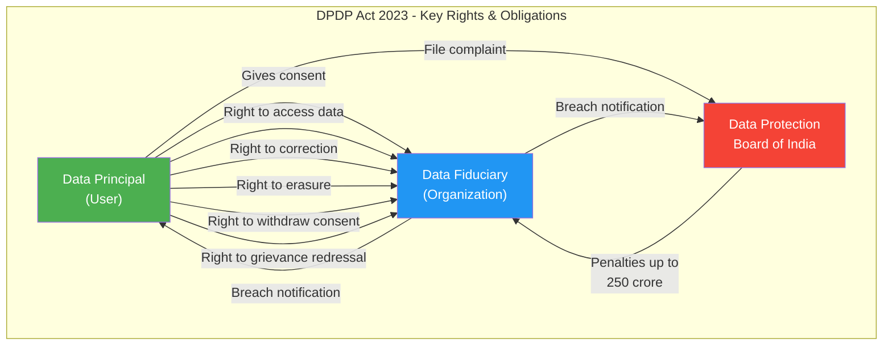
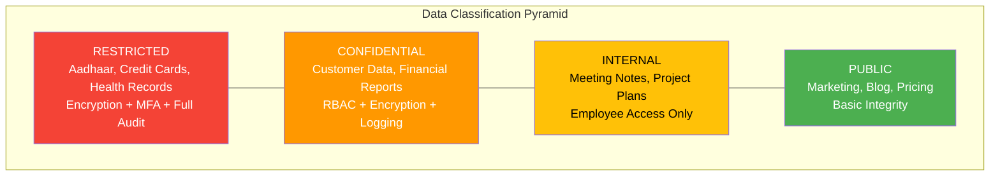
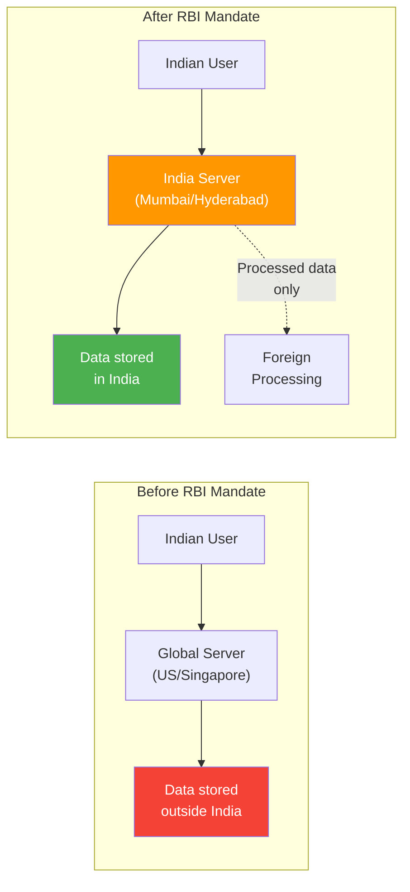
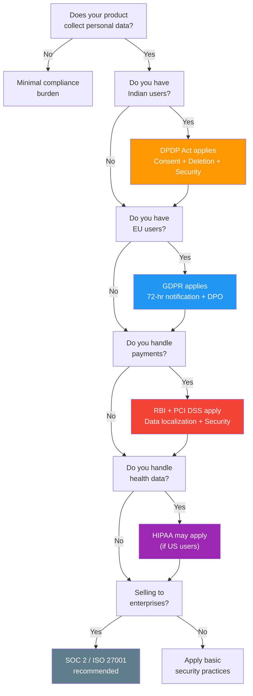

# Session 12 - Security: Data Privacy, Compliance & Regulations

## Data Privacy Laws Every PM Must Know

### The Regulatory Landscape #framework

The global trend is unmistakable: governments are tightening data privacy regulations, and penalties for non-compliance are severe. As a PM, you do not need to be a lawyer, but you must understand the laws that constrain your product decisions.

Three regulatory frameworks matter most for PMs building products in India:

1. **[[DPDP-Act]] (Digital Personal Data Protection Act, 2023)** -- India's comprehensive data privacy law
2. **[[GDPR]] (General Data Protection Regulation)** -- Europe's data privacy law (applies if you have EU users)
3. **RBI Guidelines** -- India's financial data regulations (applies to fintech and payment products)

> **The uncomfortable reality:** "We didn't know" is not a defense. Regulatory bodies have consistently held that ignorance of data privacy obligations does not excuse non-compliance. PMs who ship features without understanding privacy implications put their companies at legal and financial risk. #pm-implication

---

## India: DPDP Act 2023

### India's Data Privacy Milestone #definition

The [[DPDP-Act]] (Digital Personal Data Protection Act) was passed by the Indian Parliament in August 2023. It is India's first comprehensive data privacy law and fundamentally changes how digital products must handle personal data.

### Key Provisions #framework

**1. Consent**
- Personal data can only be processed with the user's **explicit, informed consent**
- Consent must be specific to the purpose -- a blanket "I agree to everything" is not valid
- Users must be able to withdraw consent as easily as they gave it
- Consent for children (under 18) requires verifiable parental approval

**2. Right to Deletion (Right to Erasure)**
- Users can request deletion of their personal data
- Organizations must comply within a reasonable timeframe
- Extends to data shared with third-party processors
- PM impact: Your database design must support complete user data deletion

**3. Breach Notification**
- Organizations must notify the Data Protection Board **and** affected users in case of a data breach
- Notification must include: nature of the breach, data affected, remedial measures taken
- No specific timeline mandated (unlike GDPR's 72 hours), but "without undue delay"

**4. Data Fiduciary Obligations**
- Organizations processing personal data (called "Data Fiduciaries") have specific obligations
- Must implement reasonable security safeguards
- Must ensure data accuracy and completeness
- Must delete data when the purpose is fulfilled or consent is withdrawn

**5. Penalties**
- Up to **250 crore rupees** (approximately $30 million) per violation
- Penalties are per-instance, meaning multiple violations multiply the exposure
- The Data Protection Board of India will adjudicate complaints

### PM Impact of DPDP Act #pm-implication

As a PM, the DPDP Act requires you to:

- **Design consent flows** that are clear, specific, and revocable
- **Build data deletion capabilities** into your product from day one
- **Map all personal data** your product collects, stores, and processes
- **Define data retention policies** -- how long you keep data and why
- **Plan for breach response** -- who does what if data is compromised
- **Document everything** -- consent records, processing purposes, security measures

---

## Europe: GDPR

### The Gold Standard of Data Privacy #definition

The [[GDPR]] (General Data Protection Regulation) came into effect in May 2018 and remains the most influential data privacy law worldwide. It applies to **any organization processing data of EU residents**, regardless of where the organization is headquartered.

### Key Provisions #framework

**1. Explicit Consent**
- Pre-ticked boxes are not valid consent
- Consent must be freely given, specific, informed, and unambiguous
- Separate consent required for different processing purposes
- Silence or inactivity does not constitute consent

**2. Right to Be Forgotten**
- Users can request deletion of all their personal data
- Must be honored "without undue delay" (typically within 30 days)
- Extends to all copies, backups, and third-party processors
- Exceptions: legal obligations, public interest, scientific research

**3. 72-Hour Breach Notification**
- Data breaches must be reported to supervisory authorities within **72 hours**
- If the breach poses high risk to individuals, those individuals must also be notified
- This tight timeline requires pre-planned incident response procedures

**4. Data Protection Officers (DPO)**
- Organizations processing large-scale personal data must appoint a DPO
- The DPO must be independent and report directly to senior management
- Responsible for compliance monitoring, training, and cooperation with authorities

**5. Penalties**
- Up to **20 million euros** or **4% of annual global revenue** (whichever is higher)
- Amazon was fined 746 million euros (2021); Meta was fined 1.2 billion euros (2023)
- These are not theoretical -- they are enforced aggressively

> **PM reality check:** If your product has even a handful of European users, GDPR applies to you. This is not optional, and "we're an Indian startup" is not an exemption. #pm-implication

---

## India: RBI Guidelines

### Financial Data Regulations #definition

The Reserve Bank of India ([[RBI]]) has issued specific guidelines that affect any product handling financial transactions in India.

### Key Requirements #framework

**1. Payment Data Localization**
- All payment system data must be stored **exclusively in India**
- This includes full end-to-end transaction data, not just the final record
- Foreign processors (Visa, Mastercard) had to set up local data centers
- Applies to: card transactions, UPI, wallets, net banking, AEPS

**2. KYC (Know Your Customer)**
- Customer identity must be verified before certain financial services
- Video KYC allowed (accelerated during COVID)
- Re-KYC required periodically
- Different tiers: minimum KYC (up to specified limits), full KYC (higher limits)

**3. Data Retention**
- Payment transaction data must be retained for **10 years**
- Must be available for regulatory inspection
- Conflicts with "right to erasure" under DPDP Act -- legal resolution still evolving

**4. Security Standards**
- PCI DSS compliance mandatory for card data handling
- Two-factor authentication for online transactions
- Real-time fraud monitoring
- Regular security audits by certified assessors

> **The tension:** RBI requires 10-year data retention; DPDP Act gives users the right to deletion. For fintech PMs, navigating these potentially conflicting requirements requires legal counsel and careful system design. #pm-implication

---

## The Common Thread Across Privacy Laws

### Five Universal Principles #framework

Despite differences in specifics, every major data privacy law shares these five principles:

| Principle | What It Means | PM Action |
|-----------|--------------|-----------|
| **Consent** | Users must agree to data collection | Design clear consent flows; no dark patterns |
| **Purpose Limitation** | Collect data only for stated purposes | Define and document why you need each data point |
| **Data Minimization** | Collect only what you need | Question every field on every form -- is it necessary? |
| **Right to Deletion** | Users can request data removal | Build deletion pipelines into your architecture |
| **Security Obligation** | Protect data with reasonable measures | Set security requirements; budget for security work |

> **The simplest compliance test:** For every data field your product collects, ask: "Why do we need this, who can access it, how long do we keep it, and can we delete it when asked?" If you cannot answer all four, you are not compliant. #framework

---

## PM's Security & Compliance Checklist

### 10 Items Every PM Must Verify Before Launch #framework

This checklist synthesizes the security and compliance requirements into actionable items:

- [ ] **1. HTTPS Everywhere** -- All pages and API calls use HTTPS. No exceptions, no mixed content.
- [ ] **2. Password Security** -- Passwords are hashed (bcrypt/argon2), never stored in plain text. Password strength requirements enforced.
- [ ] **3. Authentication** -- Login, registration, password reset flows are secure. Consider 2FA for sensitive features.
- [ ] **4. Authorization** -- [[RBAC]] is implemented. Users cannot access other users' data by manipulating URLs or API parameters.
- [ ] **5. Input Validation** -- All user inputs are validated and sanitized. SQL injection, XSS, and other injection attacks are prevented.
- [ ] **6. Environment Variables** -- No secrets in code. API keys, database credentials, and secrets are in [[Environment-Variables]].
- [ ] **7. Data Encryption** -- Sensitive data is encrypted at rest and in transit. Credit cards, Aadhaar numbers, health data get extra protection.
- [ ] **8. Privacy Compliance** -- Consent flows are implemented. Privacy policy is updated. Data deletion capability exists.
- [ ] **9. Logging & Monitoring** -- Security events are logged. Alerts are configured for suspicious activity. Incident response plan exists.
- [ ] **10. Third-Party Audit** -- Vendor security is assessed. Data processing agreements are signed. No unauthorized data sharing.

> **Use this checklist:** Print it. Tape it to your desk. Go through it before every major launch. Share it with your engineering lead. It will not make your product bulletproof, but it will catch the most common failures. #pm-implication

---

## Compliance Frameworks

### Standards That Prove You Are Secure #definition

[[Compliance-Frameworks]] are certifications and standards that provide structured approaches to security. They serve as both a guide for implementation and proof of compliance to customers, partners, and regulators.

| Framework | What It Covers | Who Needs It | Audit Frequency |
|-----------|---------------|--------------|-----------------|
| **SOC 2** | Security, availability, confidentiality, privacy, processing integrity | SaaS companies, B2B vendors | Annual |
| **ISO 27001** | Information security management systems (ISMS) | Enterprises, government contracts | Annual surveillance, 3-year recertification |
| **PCI DSS** | Payment card data protection | Anyone handling credit/debit card data | Annual (quarterly scans) |
| **HIPAA** | Health data protection | Healthcare and health-tech companies | Ongoing (self-assessment + audits) |
| **[[GDPR]]** | Personal data protection (EU) | Any company with EU users/data | Ongoing (no formal certification) |
| **[[DPDP-Act]]** | Personal data protection (India) | Any company processing Indian personal data | Ongoing (enforcement evolving) |

### When to Pursue Certification #pm-implication

- **Selling to enterprises?** --> They will ask for SOC 2 or ISO 27001 before signing
- **Handling payments?** --> PCI DSS is non-negotiable
- **Healthcare product?** --> HIPAA compliance is legally required
- **EU users?** --> GDPR compliance is mandatory
- **Indian users' personal data?** --> DPDP Act compliance is mandatory

> **PM tip:** Compliance certifications are expensive (SOC 2 audits cost $50K-$150K). But losing an enterprise deal because you lack SOC 2 costs more. Budget for compliance as a product investment, not an overhead expense. #pm-implication

---

## Threat Modeling Basics for PMs

### Thinking Like an Attacker #framework

Threat modeling is the practice of systematically identifying potential security threats to your application. PMs do not need to conduct technical threat modeling, but understanding the basics helps you ask better questions.

### The STRIDE Framework #definition

Microsoft's STRIDE model categorizes threats into six types:

| Threat | Description | Example | PM Question |
|--------|-------------|---------|-------------|
| **S**poofing | Pretending to be someone else | Fake login page | "How do we verify user identity?" |
| **T**ampering | Modifying data in transit or at rest | Changing order amount after checkout | "How do we ensure data integrity?" |
| **R**epudiation | Denying an action occurred | "I never made that purchase" | "Do we have audit logs?" |
| **I**nformation Disclosure | Exposing data to unauthorized parties | Database dump on the internet | "Who can access this data?" |
| **D**enial of Service | Making the system unavailable | Flooding the server with requests | "Can we handle traffic spikes?" |
| **E**levation of Privilege | Gaining unauthorized access levels | Regular user accessing admin panel | "Are access controls enforced?" |

### Simple Threat Modeling for PMs #framework

For every new feature, ask these four questions:

1. **What could go wrong?** -- What is the worst-case scenario if this feature is exploited?
2. **Who would attack this?** -- Competitors, hackers, disgruntled employees, bored teenagers?
3. **How likely is it?** -- Is this a common attack vector or a theoretical edge case?
4. **What is the impact?** -- Data loss? Financial loss? Reputational damage?

---

## Data Classification

### Not All Data Is Equal #definition

Data classification assigns sensitivity levels to data, which determines the security controls required:

**Public**
- Data intended for public consumption
- Examples: Marketing content, published blog posts, pricing pages
- Controls: Basic integrity protection (no modification by unauthorized parties)

**Internal**
- Data for internal use only, not harmful if exposed but not intended for public
- Examples: Internal meeting notes, employee directory, project plans
- Controls: Access restricted to employees; basic access controls

**Confidential**
- Data that could cause harm if exposed; business-sensitive
- Examples: Customer lists, financial reports, product roadmaps, source code
- Controls: Role-based access, encryption, audit logging, NDA requirements

**Restricted**
- Highest sensitivity; exposure causes severe harm; regulatory implications
- Examples: Credit card numbers, Aadhaar/passport data, health records, encryption keys
- Controls: Encryption at rest and in transit, strict access controls, multi-factor authentication, comprehensive audit trails, retention policies

### PM Action on Data Classification #pm-implication

For every feature, the PM should classify the data involved:

1. **Map the data:** What data does this feature collect, process, and store?
2. **Classify each field:** Public, Internal, Confidential, or Restricted?
3. **Set controls:** What security measures does each classification level require?
4. **Document in the spec:** Include data classification in your PRD

> **Example:** A user profile feature collects name (Confidential), email (Confidential), Aadhaar number (Restricted), and profile photo (Internal). Each field requires different handling. The PM must specify these differences in the requirement document. #pm-implication

---

## Privacy by Design

### Building Privacy Into the Product #framework

[[Privacy-by-Design]] is an approach where privacy is considered from the very beginning of product design, not bolted on after the fact. The [[DPDP-Act]] and [[GDPR]] both encourage or mandate this approach.

### Seven Principles #definition

1. **Proactive, not reactive** -- Anticipate privacy issues before they occur, not after a breach
2. **Privacy as default** -- The default setting should be the most privacy-protective option
3. **Privacy embedded in design** -- Privacy is a core feature, not an add-on
4. **Full functionality** -- Privacy and functionality are not trade-offs; design for both
5. **End-to-end security** -- Data is protected throughout its entire lifecycle
6. **Visibility and transparency** -- Users know what data is collected and why
7. **Respect for user privacy** -- User interests are central to design decisions

### Practical PM Application #pm-implication

| Design Decision | Privacy-Hostile | Privacy-by-Design |
|----------------|----------------|-------------------|
| Sign-up form | Collect name, email, phone, address, DOB, gender | Collect email only; ask for more only when needed |
| Analytics | Track everything; decide what to use later | Define metrics first; track only what is needed |
| Data sharing | Share with partners by default; opt-out buried | No sharing by default; clear opt-in for each partner |
| Account deletion | "Email support to request deletion" | One-click "Delete my account" in settings |
| Cookie consent | "By using this site, you agree to cookies" | Granular consent: essential, analytics, marketing |

---

## India Context: RBI Mandate and Data Localization #india-context

### Forcing Global Players to Set Up Locally #case-study

In April 2018, the RBI mandated that all payment system operators must store payment data **exclusively in India**. This had massive implications:

**What happened:**
- Visa, Mastercard, and other global payment networks had to set up data centers in India
- Companies had 6 months to comply (later extended)
- Google Pay, Amazon Pay, PhonePe, and others had to restructure their data architecture

**Why it matters:**
- Data sovereignty: Indian regulators can access payment data without depending on foreign jurisdictions
- National security: Payment data stays within Indian legal jurisdiction
- Compliance cost: Companies spent crores restructuring their data infrastructure

**PM implications:**
- If your product processes payments in India, your database must be in an Indian region
- AWS Mumbai, Azure Central India, and GCP Mumbai all support this requirement
- Third-party payment processors (Razorpay, PayU, Cashfree) handle localization for you -- one reason to use them rather than building payment processing in-house

---

## Compliance Decision Framework for PMs

### Which Laws Apply to Your Product? #framework

---

## PM Implication: Ignorance Is Not a Defense #pm-implication

### The PM's Compliance Responsibilities

**1. Know what laws apply**
- Map your user base geographically
- Identify what data you collect and process
- Determine which regulations apply (use the decision tree above)

**2. Build compliance into the product**
- Privacy-first design for new features
- Consent management as a core product capability
- Data deletion pipelines in the architecture
- Audit logging for all data access

**3. Work with legal**
- PMs are not lawyers, but they must work with legal teams
- Have legal review privacy policies, consent flows, and data processing agreements
- Escalate regulatory questions early, not after the feature is built

**4. Educate the team**
- Engineering must understand why security requirements exist
- Design must understand why consent flows must be clear
- Leadership must understand why compliance is a product investment

**5. Stay current**
- Regulations evolve; the DPDP Act rules are still being finalized
- Follow regulatory updates from MeitY (India), EDPB (EU), and RBI
- Budget for ongoing compliance work, not just one-time implementation

> **Final thought:** A PM who ships a feature that violates [[DPDP-Act]] or [[GDPR]] has not shipped a feature -- they have shipped a liability. The feature that takes two extra weeks to build right is always cheaper than the regulatory fine that could have been avoided. #pm-implication

---

## Key Takeaways

1. **Three laws matter:** DPDP Act (India), GDPR (Europe), RBI guidelines (fintech). Know which apply to your product.
2. **DPDP Act:** Consent, deletion rights, breach notification, fines up to 250 crore rupees.
3. **GDPR:** Explicit consent, right to be forgotten, 72-hour breach notification, fines up to 20 million euros or 4% of revenue.
4. **RBI:** Payment data stays in India, KYC mandatory, 10-year data retention.
5. **Five universal principles:** Consent, purpose limitation, data minimization, right to deletion, security obligation.
6. **10-item checklist:** HTTPS, password hashing, auth, RBAC, input validation, env vars, encryption, privacy, logging, vendor audit.
7. **Compliance frameworks:** SOC 2, ISO 27001, PCI DSS, HIPAA -- invest based on your customer base.
8. **Data classification:** Public, Internal, Confidential, Restricted -- not all data needs the same protection.
9. **Privacy by design:** Build privacy in from the start, not as an afterthought.
10. **Ignorance is not a defense.** PMs must ensure compliance before shipping.

---

## Related Concepts

- [[Data-Privacy]] | [[DPDP-Act]] | [[GDPR]] | [[RBI-Guidelines]]
- [[Compliance-Frameworks]] | [[SOC-2]] | [[ISO-27001]] | [[PCI-DSS]]
- [[Data-Classification]] | [[Privacy-by-Design]] | [[Threat-Modeling]]
- [[Consent-Management]] | [[Data-Retention]] | [[Data-Localization]]
- [[Authentication]] | [[Authorization]] | [[RBAC]]
- [[Security-Threats]] | [[OWASP-Top-10]] | [[Environment-Variables]]

---

*Module 1 -- Product Management II: Technology & Agile Execution | HSB | Dr. Anand Fadte*
