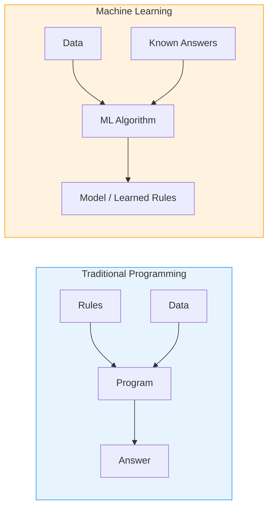
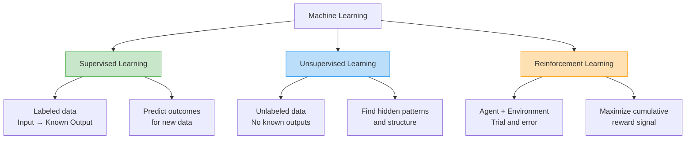
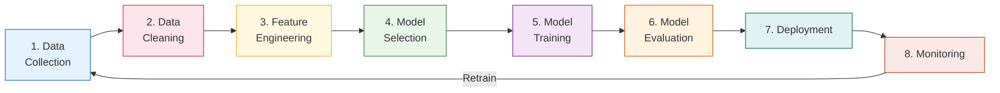
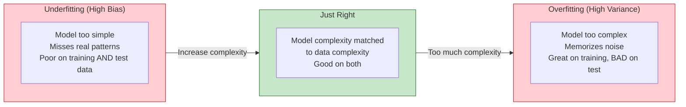

# Session 13 — Classical ML Foundations

> **Scope:** Classical machine learning only. No deep learning, no LLMs, no generative AI. Those are Session 17+.

---

## What Is Machine Learning?

[[Machine-Learning]] is the field of computer science that gives computers the ability to **learn from data without being explicitly programmed** for every possible scenario. #definition

Instead of writing rules for every situation, we feed the machine **examples** and let it discover the patterns itself.

> "A computer program is said to learn from experience E with respect to some task T and some performance measure P, if its performance on T, as measured by P, improves with experience E." -- Tom Mitchell, 1997

### Why PMs Must Understand ML

- You will not build the model, but you **define what problem it should solve**
- You set the **success metrics** by which the model is judged
- You decide **when ML is the right tool** vs. a simpler rules-based approach
- You communicate ML capabilities and limitations to stakeholders

#pm-implication PMs who cannot distinguish supervised from unsupervised learning will make poor product decisions — they will either over-promise ("AI can do anything") or under-invest ("let's just use if-then rules forever").

---

## ML vs Traditional Programming

This is the fundamental mental model shift every PM needs. #framework

### Traditional Programming
```
Rules + Data  -->  [Program]  -->  Answer
```
A human writes explicit rules. The program applies those rules to data and produces an output.

**Example:** A spam filter where engineers write rules like "if email contains 'Nigerian prince' AND sender is unknown, mark as spam."

### Machine Learning
```
Data + Answers  -->  [ML Algorithm]  -->  Rules (Model)
```
We give the algorithm **examples of inputs and correct outputs**. The algorithm discovers the rules itself.

**Example:** A spam filter trained on millions of emails labeled "spam" or "not spam." The model learns its own rules.



### When to Use ML vs Traditional Rules

| Criterion | Traditional Rules | Machine Learning |
|-----------|------------------|-----------------|
| Problem is well-defined with clear logic | Best choice | Overkill |
| Patterns are too complex for humans to code | Fails | Best choice |
| Data is abundant and labeled | Not needed | Required (supervised) |
| Decisions need to be 100% explainable | Best choice | Harder |
| Problem changes over time | Constant rewriting | Model retrains |

---

## Three Types of Machine Learning



### 1. Supervised Learning #definition

The algorithm learns from **labeled data** — every training example has an input and the correct output. The model learns to map inputs to outputs so it can predict outputs for new, unseen inputs.

**Two sub-types:**
- **Classification:** Predict a category (spam/not-spam, fraud/legitimate, churn/retain)
- **Regression:** Predict a continuous number (house price, delivery time, revenue forecast)

**Analogy:** A student studying with an answer key. They see the question and the correct answer, and learn to answer new questions.

### 2. Unsupervised Learning #definition

The algorithm works with **unlabeled data** — no correct answers are provided. The model must find hidden patterns, groupings, or structure on its own.

**Common tasks:**
- **Clustering:** Group similar items together (customer segments, document topics)
- **Dimensionality reduction:** Compress many features into fewer while preserving patterns
- **Anomaly detection:** Identify data points that do not fit any group

**Analogy:** Sorting a pile of mixed coins from a foreign country you have never visited. You do not know the denominations, but you group them by size, color, and weight.

### 3. Reinforcement Learning #definition

An agent learns by **interacting with an environment**, taking actions, and receiving rewards or penalties. The goal is to learn a strategy (policy) that maximizes cumulative reward.

**Examples:** Game-playing AI (AlphaGo), robotics, dynamic pricing, ad bidding strategies

**Analogy:** Training a dog. You do not explain the rules — you reward good behavior and the dog learns what to repeat.

---

## Supervised Learning Algorithms for PMs

PMs do not need to implement these, but you must know **what each does, when to use it, and its tradeoffs**. #framework

### Linear Regression
- **What:** Fits a straight line through data to predict a continuous value
- **When:** Predict sales revenue, estimate delivery times, forecast demand
- **Strength:** Simple, interpretable, fast
- **Weakness:** Assumes a linear relationship — real world is often non-linear
- **PM example:** Predicting how much revenue a new feature will generate based on historical data

### Logistic Regression
- **What:** Despite the name, it is a **classification** algorithm. Predicts probability of belonging to a class (0 or 1)
- **When:** Churn prediction, click-through rate, loan default prediction
- **Strength:** Outputs probabilities (not just yes/no), highly interpretable
- **Weakness:** Assumes linear decision boundary
- **PM example:** "What is the probability this user will churn in the next 30 days?"

### [[Decision-Trees]]
- **What:** A flowchart-like tree where each node splits data on a feature
- **When:** Customer segmentation, eligibility decisions, risk scoring
- **Strength:** Extremely interpretable — you can show stakeholders the exact logic
- **Weakness:** Prone to [[Bias-Variance-Tradeoff|overfitting]] on noisy data
- **PM example:** Loan approval — "If income > 50K AND employment > 2 years AND debt ratio < 0.3, approve"

### [[Random-Forests]]
- **What:** An ensemble of many decision trees, each trained on a random subset of data. Final prediction = majority vote
- **When:** Almost any classification/regression task — the "Swiss Army knife" of ML
- **Strength:** Robust, handles missing data, resists overfitting
- **Weakness:** Less interpretable than a single decision tree
- **PM example:** Fraud detection — combining hundreds of decision trees for more reliable predictions

### k-Nearest Neighbors (k-NN)
- **What:** Classifies a data point based on what its k closest neighbors are
- **When:** Recommendation ("users similar to you liked..."), simple classification
- **Strength:** Intuitive, no training phase
- **Weakness:** Slow on large datasets, sensitive to irrelevant features
- **PM example:** "Show me 5 products that customers similar to me purchased"

### Support Vector Machines (SVM)
- **What:** Finds the optimal boundary (hyperplane) that separates classes with maximum margin
- **When:** Text classification, image classification, when data has many features
- **Strength:** Works well in high-dimensional spaces
- **Weakness:** Does not scale well to very large datasets
- **PM example:** Classifying support tickets into categories

### Gradient Boosting (XGBoost)
- **What:** Builds trees sequentially, where each new tree corrects errors of the previous ones
- **When:** Kaggle competitions, structured/tabular data, any high-performance need
- **Strength:** Often the best-performing algorithm on structured data
- **Weakness:** Requires careful tuning, can overfit
- **PM example:** Predicting customer lifetime value using dozens of behavioral features

---

## Unsupervised Learning for PMs

### [[Unsupervised-Learning|k-Means Clustering]]
- **What:** Partitions data into k groups where each point belongs to the nearest cluster center
- **When:** Customer segmentation, market segmentation, document grouping
- **PM example:** Segment users into "power users," "casual browsers," "deal seekers," and "dormant" groups to tailor product experiences #india-context — Flipkart segments its 400M+ users for personalized homepage experiences

### Hierarchical Clustering
- **What:** Builds a tree (dendrogram) of nested clusters — you can cut at any level
- **When:** When you do not know how many clusters exist in advance, taxonomy creation
- **PM example:** Organizing a product catalog into a hierarchy of categories

### PCA (Principal Component Analysis)
- **What:** Reduces many features to fewer dimensions while preserving maximum variance
- **When:** Data has too many features, visualization of high-dimensional data
- **PM example:** You track 200 user behavior metrics. PCA reveals that 5 underlying patterns explain 90% of the variation

---

## The ML Workflow Pipeline

Every ML project follows this pipeline, and PMs must understand each stage to set realistic expectations and timelines. #framework



### Stage Details

| Stage | What Happens | PM Role | % of Time |
|-------|-------------|---------|-----------|
| Data Collection | Gather raw data from sources | Define what data is needed, ensure legal compliance | 10% |
| Data Cleaning | Handle missing values, duplicates, errors | Understand data quality issues, set quality bar | 25% |
| [[Feature-Engineering]] | Create input variables from raw data | Provide domain expertise on what matters | 25% |
| Model Selection | Choose algorithm(s) to try | Understand tradeoffs (speed vs accuracy vs interpretability) | 5% |
| Training | Algorithm learns from data | Wait patiently, provide compute budget | 10% |
| Evaluation | Measure model performance | Define success criteria, validate against business metrics | 10% |
| Deployment | Put model into production | Coordinate with engineering, plan rollout | 10% |
| Monitoring | Track performance over time | Own the metrics dashboard, trigger retraining | 5% |

> **The 80/20 reality:** Data scientists spend roughly **80% of their time on data collection, cleaning, and feature engineering** — not on the "glamorous" model training. PMs who do not understand this will set unrealistic timelines.

---

## Bias-Variance Tradeoff

This is one of the most important concepts in ML for understanding why models fail. #framework



### [[Bias-Variance-Tradeoff]] Explained Simply

- **Bias (underfitting):** The model is too simple. It has strong assumptions that do not match reality. Like a student who only memorized "the answer is always C" — they will get some right by luck, but fail overall.
- **Variance (overfitting):** The model is too complex. It memorized the training data including its noise. Like a student who memorized every answer in the practice exam but cannot answer a slightly different question.
- **The sweet spot:** A model complex enough to capture real patterns, but simple enough to generalize to new data.

#pm-implication When your data science team says "the model performs great on training data but poorly in production," the likely culprit is **overfitting**. PMs should always ask: "What is performance on the **held-out test set**, not the training set?"

---

## Evaluation Metrics

### [[ML-Evaluation-Metrics|The Confusion Matrix]]

For a binary classifier (e.g., "is this transaction fraud?"):

|  | Predicted: Fraud | Predicted: Not Fraud |
|--|-----------------|---------------------|
| **Actually Fraud** | True Positive (TP) | False Negative (FN) — Missed fraud |
| **Actually Not Fraud** | False Positive (FP) — False alarm | True Negative (TN) |

### Key Metrics #definition

- **Accuracy** = (TP + TN) / Total — Overall correctness
- **Precision** = TP / (TP + FP) — "Of all items I flagged, how many were correct?" (minimize false alarms)
- **Recall** = TP / (TP + FN) — "Of all actual positives, how many did I catch?" (minimize missed cases)
- **F1-Score** = 2 x (Precision x Recall) / (Precision + Recall) — Harmonic mean balancing both

### When Accuracy Misleads: The Class Imbalance Problem

#case-study **Fraud Detection Example:**
- Dataset: 10,000 transactions. 9,900 legitimate, 100 fraudulent.
- A model that **always predicts "not fraud"** achieves **99% accuracy**.
- But it catches **zero fraud** — it is completely useless.
- **Recall = 0%**. The metric that matters here is recall, not accuracy.

**The lesson for PMs:** Always ask your data science team **which metric they are optimizing** and **why that metric aligns with the business goal**. Different problems demand different metrics:

| Problem | Priority Metric | Why |
|---------|----------------|-----|
| Spam filter | Precision | Users hate legitimate emails going to spam |
| Cancer screening | Recall | Missing a cancer case is far worse than a false alarm |
| Search ranking | NDCG / AUC-ROC | Need to rank results, not just classify |
| Fraud detection | Recall + Precision (F1) | Must catch fraud without blocking good users |

### AUC-ROC Curve
- **AUC** (Area Under the Curve) of the **ROC** (Receiver Operating Characteristic) curve
- Measures how well the model separates positive and negative classes across all thresholds
- AUC = 0.5 means random guessing; AUC = 1.0 means perfect separation
- #pm-implication AUC is threshold-independent — useful when you have not yet decided the cutoff point

---

## Feature Engineering

[[Feature-Engineering]] is the process of **creating informative input variables** from raw data that help the model learn better. #definition

### Examples

| Raw Data | Engineered Feature | Why It Helps |
|----------|-------------------|-------------|
| Timestamp of purchase | Hour of day, day of week, is_weekend | Captures behavioral patterns |
| Date of birth | Age, age_bucket (18-25, 26-35...) | More predictive than raw date |
| Latitude + longitude | Distance to nearest store | Directly relevant to delivery prediction |
| Purchase history | Recency, Frequency, Monetary (RFM) | Classic customer value segmentation |
| Text review | Word count, sentiment score, has_emoji | Structured features from unstructured text |

#pm-implication Feature engineering is where **PM domain knowledge is most valuable**. A PM who understands the business can suggest features that data scientists would never think of. Example: "For churn prediction, I think 'days since last customer support contact' would be predictive."

---

## Case Studies

### Spam Filters (Naive Bayes) #case-study

Gmail's original spam filter used **Naive Bayes classification** — a supervised algorithm that calculates the probability of an email being spam based on the words it contains.

- **Training data:** Millions of emails labeled spam/not-spam by users clicking "Report Spam"
- **Features:** Word frequencies, sender reputation, link patterns
- **Why it works:** Simple, fast, and surprisingly effective for text classification
- **PM lesson:** Sometimes the simplest algorithm wins. Do not over-engineer.

### Recommendation Engines (Collaborative Filtering) #case-study

Amazon's "Customers who bought X also bought Y" uses **collaborative filtering** — an [[Unsupervised-Learning|unsupervised/hybrid]] technique.

- **User-based:** Find users similar to you, recommend what they liked
- **Item-based:** Find items similar to what you liked, recommend those
- **Cold start problem:** New users/items have no history — a major PM challenge
- **PM lesson:** Recommendation quality depends on data volume. Plan for the cold-start phase.

### Credit Scoring #case-study #india-context

Indian fintech companies like CRED and Slice use [[Random-Forests]] and gradient boosting to score creditworthiness beyond traditional CIBIL scores.

- **Features:** UPI transaction patterns, bill payment history, app usage behavior, social signals
- **Challenge:** Bias in training data can discriminate against certain demographics
- **PM lesson:** Model fairness is a product decision, not just a technical one. See [[ML-Ethics]].

---

## Key Takeaways for PMs

1. **ML learns rules from data** — you define what problem to solve and how to measure success
2. **Supervised = labeled data, Unsupervised = find patterns, Reinforcement = trial and error**
3. **80% of ML work is data preparation** — set timelines accordingly
4. **Accuracy can be misleading** — always align the evaluation metric to the business goal
5. **Feature engineering is where PM domain knowledge shines** — contribute your understanding of the user
6. **Overfitting is the #1 silent killer** — always ask about test set performance, not training performance

---

## Discussion Questions

1. For a food delivery app predicting delivery time, would you use regression or classification? What features would you engineer?
2. Your data science team reports 95% accuracy on a churn prediction model. What questions should you ask before celebrating?
3. When would you choose a simple decision tree over a more powerful random forest, and why?

---

*Next session: [[Session-14-Applied-ML]] — Taking ML from algorithms to real products*
