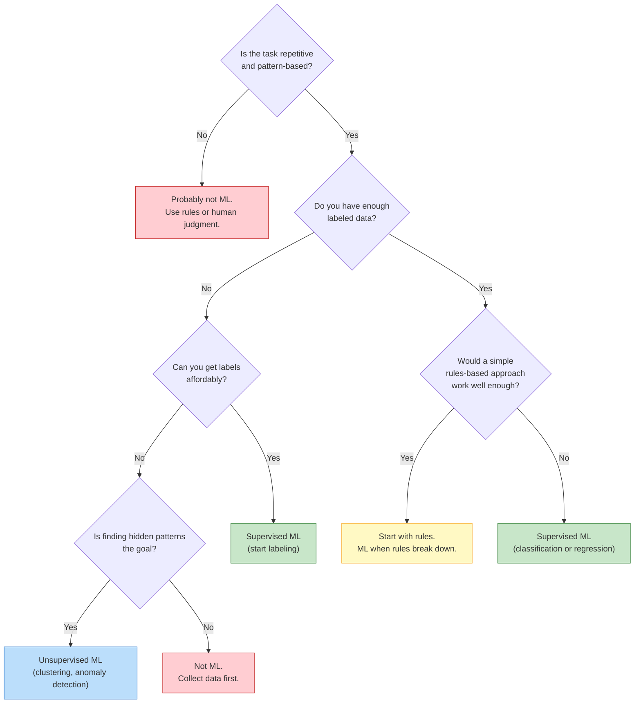
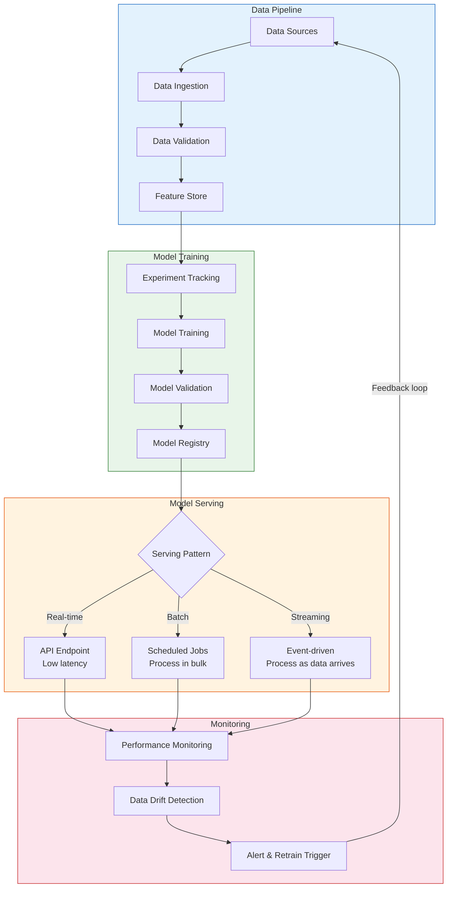
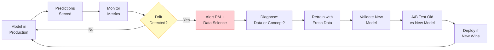
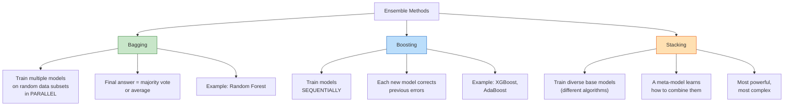

# Session 14 — Applied ML for Product Managers

> **Bridge from theory to practice:** Session 13 covered what ML algorithms are. This session covers how to **ship ML as a product feature** — from choosing the right application to monitoring it in production.

---

## ML Product Applications by Category

Not every product needs ML, but every PM must know the **categories of problems ML solves well**. #framework

### Application Taxonomy

| Category | What It Does | Example Products | Typical Algorithm |
|----------|-------------|------------------|-------------------|
| **Recommendation** | Suggest items users may like | Netflix, Spotify, Amazon | Collaborative filtering, matrix factorization |
| **Search & Ranking** | Order results by relevance | Google, Flipkart, LinkedIn | Learning-to-rank, gradient boosting |
| **Fraud Detection** | Flag suspicious activity | PhonePe, Stripe, PayPal | [[Random-Forests]], anomaly detection |
| **Demand Forecasting** | Predict future demand | Uber surge pricing, inventory planning | Time series models, XGBoost |
| **Churn Prediction** | Identify users likely to leave | SaaS products, telecom, streaming | Logistic regression, gradient boosting |
| **Pricing Optimization** | Set dynamic prices | Airlines, Ola, hotel platforms | Reinforcement learning, regression |
| **NLP: Sentiment Analysis** | Classify text as positive/negative | App reviews, social listening | Naive Bayes, SVM, text classifiers |
| **NLP: Text Classification** | Route text to categories | Support ticket routing, content moderation | SVM, logistic regression, Naive Bayes |
| **Image Recognition** | Identify objects in images | Quality control, medical imaging | (Note: uses deep learning — Session 17+) |

### The "ML or Not" Decision Tree

---

## The PM's ML Feature Checklist

Before greenlighting any ML feature, every PM must answer these questions. #framework

### Pre-Build Checklist

1. **What data do we have?** Inventory your data assets — what is collected, where it lives, how clean it is
2. **Is it labeled?** Supervised learning requires labels. If not, who will label it? At what cost?
3. **How much data?** Rule of thumb: thousands of examples for simple problems, hundreds of thousands for complex ones
4. **How fresh does it need to be?** Real-time (fraud) vs. daily batch (recommendations) vs. monthly (churn)
5. **What is the baseline without ML?** What does the current rules-based or manual approach achieve? If the baseline is already 95%, ML might add marginal value at high cost
6. **What is the cost of errors?** False positives vs. false negatives — which is more expensive for your business?
7. **Is the problem stationary?** Do the patterns change over time? If yes, plan for [[Model-Drift|model drift]] and retraining
8. **Can we explain the decision?** Regulated industries (lending, insurance, healthcare) may require interpretable models
9. **What is the fallback?** If the model fails or produces garbage, what happens? Is there a human-in-the-loop?
10. **How will we measure success?** Define the business metric (not just model accuracy) that proves the feature works

#pm-implication Answering "I don't know" to questions 1-3 means you are not ready to build an ML feature. Go collect data first.

---

## MLOps: From Notebook to Production

[[MLOps]] is the discipline of **deploying, monitoring, and maintaining ML models in production**. It is the ML equivalent of DevOps. #definition

### Why MLOps Matters for PMs

Most ML projects fail not because the model was bad, but because the team could not **reliably put it into production and keep it running**. Google's famous paper found that ML code is a tiny fraction of a real ML system — the rest is infrastructure.

### The MLOps Pipeline

### Key MLOps Components

| Component | What It Does | Example Tools |
|-----------|-------------|---------------|
| **Feature Store** | Central repository of reusable features | Feast, Tecton, Hopsworks |
| **Experiment Tracking** | Log and compare model experiments | MLflow, Weights & Biases, Neptune |
| **Model Registry** | Version and store trained models | MLflow Model Registry, SageMaker |
| **Model Serving** | Deploy models as APIs or batch jobs | TensorFlow Serving, Seldon, BentoML |
| **Monitoring** | Track model performance in production | Evidently AI, Fiddler, WhyLabs |

---

## Model Drift: Why Models Degrade

[[Model-Drift]] is the phenomenon where a deployed model's performance **degrades over time** because the real-world data distribution changes. #definition

### Types of Drift

- **Data drift (covariate shift):** The input data distribution changes. Example: user demographics shift after a marketing campaign targets a new segment.
- **Concept drift:** The relationship between input and output changes. Example: what users consider "relevant" search results evolves over time.
- **Label drift:** The distribution of outcomes changes. Example: fraud patterns evolve as attackers adapt.

### The Model Monitoring Feedback Loop

### Retraining Strategies

| Strategy | When to Use | Example |
|----------|------------|---------|
| **Scheduled** (weekly/monthly) | Gradual drift, stable domain | Recommendation engines |
| **Triggered** (on metric drop) | Sudden drift, critical applications | Fraud detection |
| **Continuous** (online learning) | Fast-changing patterns | Ad click prediction |

#pm-implication PMs must plan for retraining **before launch**, not after the model degrades. Include retraining cadence, compute costs, and data freshness requirements in the ML PRD.

---

## A/B Testing ML Features

Standard A/B testing principles apply, but ML features have unique challenges. #framework

### What Makes ML A/B Tests Different

1. **Delayed feedback:** Recommendation quality may take weeks to show in retention metrics
2. **Novelty effects:** Users may engage with ML-powered features simply because they are new — measure long-term, not just week one
3. **Network effects:** In two-sided marketplaces, improved ranking for one side affects the other
4. **Proxy vs. business metrics:** A model may improve click-through rate (proxy) while decreasing purchase conversion (business metric)

### A/B Testing Framework for ML Features

| Phase | Duration | What to Measure |
|-------|----------|----------------|
| **Offline evaluation** | Before launch | Model metrics (AUC, precision, recall) on held-out test set |
| **Shadow mode** | 1-2 weeks | Run new model alongside old, compare outputs without showing to users |
| **Limited A/B test** | 2-4 weeks | 5-10% traffic, measure guardrail metrics (latency, errors) |
| **Full A/B test** | 4-8 weeks | 50/50 split, measure business metrics (revenue, retention, NPS) |
| **Gradual rollout** | 1-2 weeks | Ramp from 50% to 100%, monitor for edge cases |

---

## Interpretability and Explainability

### Why "Black Box" Is a Problem for PMs

Many ML models — especially [[Ensemble-Methods|ensembles]] and deep learning — cannot easily explain **why** they made a specific prediction. This creates problems: #framework

1. **Regulatory compliance:** EU's GDPR Article 22 grants a "right to explanation" for automated decisions. India's DPDP Act has similar provisions. #india-context
2. **User trust:** "The algorithm denied your loan" is unacceptable without explanation
3. **Debugging:** When the model makes mistakes, you need to understand why
4. **Stakeholder buy-in:** Executives will not trust a model they cannot understand

### [[SHAP-LIME|Key Interpretability Tools]]

#### SHAP (SHapley Additive exPlanations)
- Based on game theory — assigns each feature an "importance score" for a specific prediction
- **Example:** "This loan was denied because: income contributed -40%, debt ratio contributed -30%, employment history contributed +15%, age contributed +5%"
- **PM use:** Generate per-user explanations for automated decisions

#### LIME (Local Interpretable Model-agnostic Explanations)
- Creates a simple, interpretable model **locally** around a specific prediction
- **Example:** For a specific user, LIME shows that changing "number of support tickets" from 5 to 1 would flip the churn prediction from "will churn" to "will stay"
- **PM use:** Understand what levers drive individual predictions

### Interpretability Spectrum

| Model Type | Interpretability | Performance | When to Choose |
|-----------|-----------------|-------------|----------------|
| Linear/Logistic Regression | Very high | Lower | Regulated decisions, need full transparency |
| [[Decision-Trees]] | High | Moderate | Stakeholder presentations, initial prototypes |
| [[Random-Forests]] | Medium (with SHAP) | High | Balance of performance and explainability |
| Gradient Boosting (XGBoost) | Medium (with SHAP) | Very high | Performance-critical, can invest in explanation layer |
| Neural Networks | Low | Highest | Unregulated, perception tasks (image, speech) |

---

## Ethics and Fairness in ML

[[ML-Ethics]] is not a nice-to-have — it is a **product risk** that can destroy trust, invite regulation, and cause real harm. #framework

### Sources of Bias in ML

1. **Historical bias:** Training data reflects past discrimination. If past hiring data shows gender bias, the model learns to discriminate.
2. **Representation bias:** Training data over-represents some groups. Voice recognition trained mostly on American English accents fails for Indian English speakers. #india-context
3. **Measurement bias:** Features proxy for protected characteristics. ZIP code can proxy for race; smartphone model can proxy for income.
4. **Aggregation bias:** One model for diverse populations. A health model trained on one demographic may fail for another.
5. **Feedback loops:** Biased model creates biased data for retraining. Predictive policing sends more police to flagged neighborhoods, generating more arrests, reinforcing the bias.

### Fairness Metrics PMs Should Know #definition

- **Demographic parity:** All groups receive positive outcomes at equal rates
- **Equal opportunity:** True positive rates are equal across groups
- **Predictive parity:** Precision is equal across groups
- **Disparate impact ratio:** If selection rate for any group is less than 80% of the highest-rate group, there may be illegal discrimination (US "4/5ths rule")

### PM Responsibilities for ML Fairness

1. **Audit training data** for demographic representation before model building begins
2. **Define fairness criteria** upfront — which metrics, which protected groups
3. **Require fairness testing** as a release gate — do not ship without it
4. **Plan for appeals** — humans must be able to override model decisions
5. **Document model limitations** — what the model was and was not trained on

---

## Ensemble Methods

[[Ensemble-Methods]] combine multiple models to produce better predictions than any single model alone. "Wisdom of crowds" for algorithms. #definition

### Three Ensemble Strategies

### When to Use Ensembles

| Method | Strengths | Weaknesses | Best For |
|--------|----------|------------|----------|
| **Bagging** | Reduces variance, resists overfitting | Does not reduce bias | High-variance models (decision trees) |
| **Boosting** | Reduces bias AND variance | Can overfit noisy data, slower to train | Structured/tabular data competitions |
| **Stacking** | Can outperform any single method | Complex to implement and maintain | Final percentage-point improvements |

#pm-implication For most product ML, **gradient boosting (XGBoost/LightGBM)** on structured data or a **random forest** as a starting point will get you 90% of the way. The final 2-3% improvement from complex stacking is rarely worth the engineering complexity.

---

## India ML Case Studies

### Flipkart Search Ranking #case-study #india-context

**Problem:** Rank millions of products for each search query across 150M+ monthly active users.

**Approach:**
- Learning-to-rank using gradient boosting (LambdaMART)
- Features: query-product relevance, click-through history, product quality signals, seller rating, delivery speed, price competitiveness
- Re-ranked in real-time based on user's location, past behavior, and session context

**PM Lesson:** Search is not a "set and forget" feature. The ranking model must be continuously retrained as catalog, user behavior, and seasonality change. The PM owns the definition of "relevant" — is it what users click, what they buy, or what they do not return?

### Swiggy Delivery Time Prediction #case-study #india-context

**Problem:** Predict accurate delivery times across 500+ cities with wildly different conditions.

**Approach:**
- [[Ensemble-Methods|Ensemble]] of gradient boosting models
- Features: restaurant preparation time (historical), distance, real-time traffic, weather, time of day, day of week, delivery partner density, order complexity
- Separate models for different city tiers (Tier 1 cities have different patterns than Tier 3)

**PM Lesson:** Under-promising delivery time loses orders. Over-promising destroys trust. The PM must decide the **asymmetry of errors** — is it worse to say "30 min" and deliver in 45, or to say "50 min" and deliver in 35? Most PMs choose slight over-estimation for trust.

### CRED Credit Scoring #case-study #india-context

**Problem:** Score creditworthiness for premium credit card users beyond traditional CIBIL scores.

**Approach:**
- [[Random-Forests]] and XGBoost on alternative data: bill payment patterns, UPI transaction behavior, app engagement
- [[Feature-Engineering]]: "payment consistency score," "spending-to-income ratio," "category diversity index"

**PM Lesson:** Alternative credit scoring expands access to financial services but introduces fairness risks. What if "app engagement" correlates with age or smartphone quality, creating a proxy for income discrimination?

### PhonePe Fraud Detection #case-study #india-context

**Problem:** Detect fraudulent UPI transactions in real-time across 450M+ users.

**Approach:**
- Real-time anomaly detection using [[Ensemble-Methods|ensemble methods]]
- Features: transaction amount vs. user history, time patterns, device fingerprint, location anomalies, beneficiary risk score
- Two-stage system: fast rules-based filter (catches obvious fraud) + ML model (catches sophisticated fraud)

**PM Lesson:** The two-stage approach is a pattern — use simple rules for clear cases and ML for edge cases. This reduces latency (rules are instant) and cost (ML inference is expensive at scale).

---

## Writing ML PRDs

#pm-implication When writing a PRD for an ML-powered feature, include these sections beyond a standard PRD:

### ML PRD Template Additions

1. **Problem formulation:** What specific prediction or classification does the model make?
2. **Data requirements:** What training data exists, how much, how labeled, any gaps?
3. **Success metrics:** Business metric (revenue lift, churn reduction) AND model metric (precision, recall)
4. **Baseline:** Current performance without ML — this is the bar the model must clear
5. **Evaluation plan:** Offline metrics, shadow mode plan, A/B test design
6. **Fairness requirements:** Protected groups, fairness metrics, audit plan
7. **Latency requirements:** How fast must the prediction be? Real-time (< 100ms) or batch (hours)?
8. **Failure mode:** What happens when the model is wrong or unavailable? Fallback strategy?
9. **Retraining plan:** How often, triggered by what, at what compute cost?
10. **Interpretability needs:** Do we need per-prediction explanations? For whom?

### When ML Is Overkill

ML is overkill when: #framework
- A simple threshold or rule achieves 90%+ of the desired outcome
- You have fewer than 1,000 labeled examples
- The problem does not change over time (static rules suffice)
- The cost of building and maintaining the model exceeds the value
- You cannot measure whether the ML feature improved the outcome

### When ML Is Essential

ML is essential when:
- Patterns are too complex for humans to codify (natural language, image recognition)
- The problem involves personalization at scale (millions of users, each different)
- Patterns change over time and the system must adapt (fraud, search relevance)
- The volume of decisions exceeds human capacity (content moderation at scale)

---

## Key Takeaways for PMs

1. **Know the ML application categories** — match business problems to ML solution types
2. **Use the PM's ML checklist** before committing to any ML feature
3. **[[MLOps]] is where ML projects die** — plan for deployment and monitoring from day one
4. **[[Model-Drift]] is inevitable** — budget for retraining and monitoring in your roadmap
5. **A/B test ML features like any other feature** — but account for delayed feedback and novelty
6. **Interpretability is not optional** — regulatory, trust, and debugging all require it
7. **[[ML-Ethics|Fairness]] is a product decision** — audit data, define metrics, and plan for appeals
8. **ML PRDs need extra sections** — data, metrics, fairness, failure modes, retraining

---

## Discussion Questions

1. Your search ranking team says "We improved NDCG by 3%." How do you translate that into a business impact your VP will care about?
2. A model trained on Bangalore user data is being deployed to Tier-3 cities. What could go wrong?
3. Your fraud model flags 5% of all transactions. Customer complaints about false blocks are rising. How do you balance fraud catch rate vs. user experience?

---

*Next session: [[Session-15-Build-vs-Buy]] — Deciding what to build, what to buy, and what to partner for*
