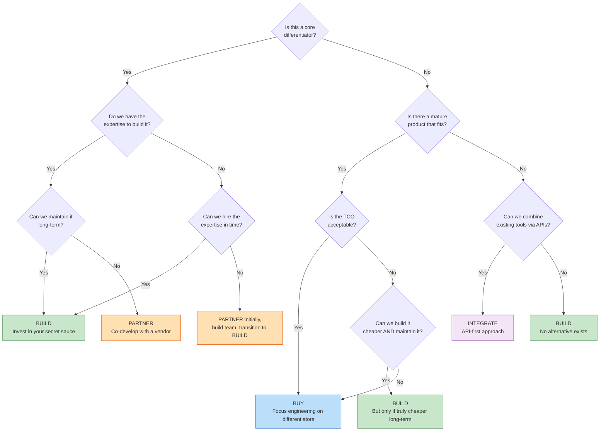
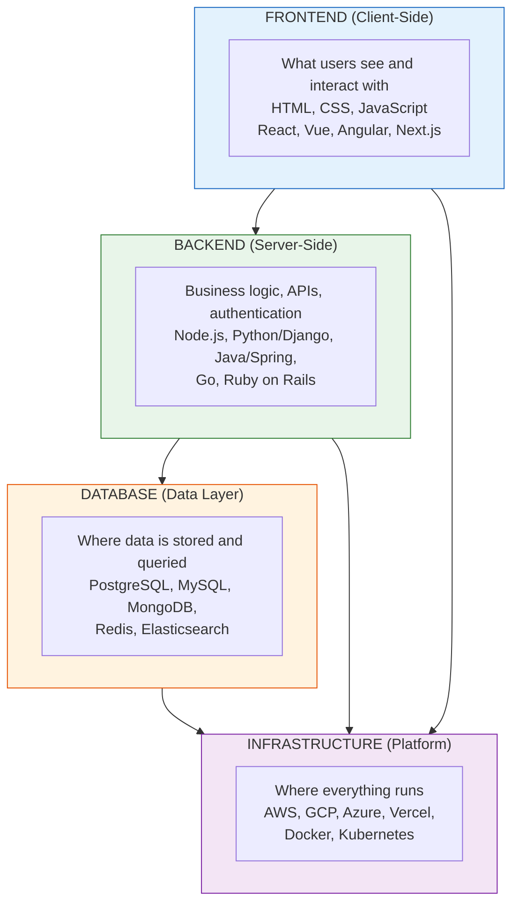
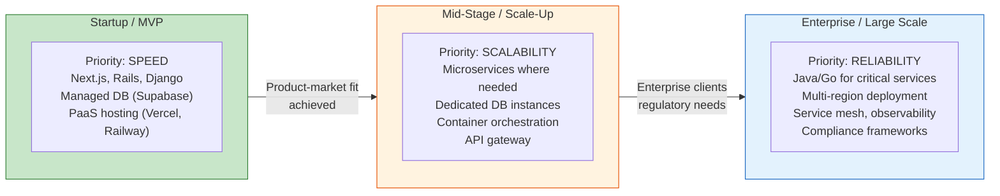
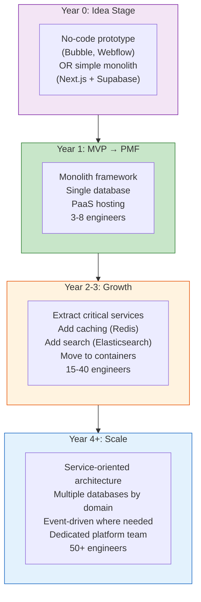

# Session 15 — Build vs Buy & Tech Stacks

> **Core principle:** "Secret sauce = build, plumbing = buy." Every engineering hour spent on commodity infrastructure is an hour stolen from your product's differentiator.

---

## The Build vs Buy Decision Framework

[[Build-vs-Buy]] is one of the most consequential decisions a PM influences. It determines where engineering resources go, what your cost structure looks like, and how fast you can move. #framework

### The Fundamental Question

> "Is this capability a **core differentiator** that creates competitive advantage, or is it **plumbing** that every company needs but none competes on?"

| Capability Type | Decision | Example |
|----------------|----------|---------|
| **Core differentiator** | BUILD | Flipkart's search ranking algorithm |
| **Important but commodity** | BUY | Payment gateway (Razorpay), email delivery (SendGrid) |
| **Complementary capability** | PARTNER / INTEGRATE | Maps (Google Maps API), identity verification (DigiLocker) |

### The Build vs Buy Decision Tree



---

## The 6 Dimensions of Build vs Buy

Every build-vs-buy decision must be evaluated across these six dimensions. #framework

### 1. Cost

| Factor | Build | Buy |
|--------|-------|-----|
| Upfront | Engineering salaries, infrastructure | License fees, implementation |
| Ongoing | Maintenance, upgrades, bug fixes | Subscription, per-seat/per-usage fees |
| Hidden | Opportunity cost — what else could engineers build? | Integration, customization, vendor lock-in migration |

### 2. Time to Market

- **Build:** Weeks to months (or years) for a custom solution
- **Buy:** Days to weeks for implementation
- **PM calculus:** If a competitor ships the feature in 3 months and building takes 9, buying for 6-week deployment wins

### 3. Control

- **Build:** Full control over features, roadmap, architecture, and data
- **Buy:** Limited to vendor's roadmap, configuration options, and API surface
- **Key question:** "How often do we need to customize this beyond what any vendor offers?"

### 4. Maintenance Burden

- **Build:** Your team owns every bug, every security patch, every upgrade
- **Buy:** Vendor handles maintenance (in theory — integration maintenance is still yours)
- **The iceberg:** Initial build is 20% of lifetime cost. Maintenance is 80%. Most teams underestimate this. #pm-implication

### 5. Expertise

- **Build:** Requires deep expertise in the domain. Can you hire and retain those specialists?
- **Buy:** Vendor has assembled a team of specialists you could never afford individually
- **Hiring reality in India:** #india-context Some expertise (ML infrastructure, distributed systems) is extremely scarce. Building means competing with Google, Amazon, and Flipkart for the same talent pool.

### 6. Strategic Value

- **Build:** Creates IP, deepens moats, enables unique capabilities
- **Buy:** Frees resources for strategic work, but creates vendor dependency
- **The test:** "Would an investor value us more because we built this ourselves?"

---

## Total Cost of Ownership (TCO)

[[Build-vs-Buy|TCO]] goes far beyond the sticker price. #definition

### TCO Breakdown: Buying a SaaS Tool

```
License/Subscription Fees        (the price you see)
+ Implementation & Setup          (consulting, configuration)
+ Integration Development         (connecting to your systems)
+ Data Migration                  (moving from old system)
+ Training                        (getting your team up to speed)
+ Customization                   (making it fit your workflow)
+ Ongoing Integration Maintenance (when their API changes)
+ Scaling Costs                   (per-seat or per-usage growth)
+ Exit Costs                      (migration when you switch)
────────────────────────────────
= True Total Cost of Ownership
```

### TCO Breakdown: Building In-House

```
Engineering Salaries              (design + build)
+ Infrastructure Costs            (compute, storage, networking)
+ Opportunity Cost                (what else could the team build?)
+ Maintenance & Bug Fixes         (ongoing forever)
+ Security Patches                (ongoing forever)
+ Documentation & Training        (for new team members)
+ Knowledge Concentration Risk    (what if the builder leaves?)
+ Scaling Engineering             (as usage grows)
────────────────────────────────
= True Total Cost of Ownership
```

#pm-implication The most dangerous phrase in build-vs-buy is **"It's just a few weeks of engineering."** Always ask: "And how many weeks of maintenance per year, for how many years?"

---

## When to Build, When to Buy, When to Partner

### When to BUILD

1. **Core differentiator** — This is what makes your product unique
2. **Unique requirements** — No vendor solution fits your specific needs
3. **Data sensitivity** — You cannot let data leave your infrastructure (healthcare, defense)
4. **Long-term cost advantage** — At your scale, building is genuinely cheaper over 3+ years
5. **Team has the expertise** — And you can retain them

**Example:** Zerodha built its own trading platform (Kite) rather than licensing one. Trading execution speed and UX are their core differentiator. #india-context

### When to BUY

1. **Commodity function** — Authentication, email, payments, analytics — everyone needs it, no one competes on it
2. **Faster time-to-market** — Speed matters more than customization right now
3. **Proven, mature solution** — The vendor has solved edge cases you have not imagined yet
4. **Team lacks expertise** — And hiring for it is not strategic
5. **Regulatory compliance** — The vendor handles compliance (PCI-DSS for payments, SOC 2 for security)

**Example:** Nearly every Indian startup uses Razorpay for payments instead of building a payment gateway. Payments are critical but not a differentiator for most companies.

### When to PARTNER / INTEGRATE

1. **Complementary capability** — Maps, weather data, identity verification
2. **Shared ecosystem** — You both benefit from integration (CRM + email marketing)
3. **API-first approach** — The partner exposes clean APIs for deep integration
4. **Cost sharing** — Neither party can justify building the full solution alone

**Example:** Ola integrates Google Maps for routing rather than building its own mapping platform. Maps are essential but not Ola's differentiator — ride availability and pricing are.

---

## Tech Stacks Overview

### What Is a Tech Stack?

A [[Tech-Stacks|tech stack]] is the **combination of technologies used to build and run a software product** — the programming languages, frameworks, databases, and infrastructure that together form the application. #definition

### The Four Layers



---

## Popular Stack Combinations

### Classic Stacks

| Stack Name | Components | Era | Best For |
|-----------|------------|-----|----------|
| **LAMP** | Linux, Apache, MySQL, PHP | 2000s | WordPress sites, simple web apps |
| **MEAN** | MongoDB, Express.js, Angular, Node.js | 2013+ | Full-stack JavaScript apps |
| **MERN** | MongoDB, Express.js, React, Node.js | 2015+ | Modern single-page apps |
| **Django + React** | Python/Django backend, React frontend | 2016+ | Data-heavy apps, ML integration |
| **Spring + Angular** | Java/Spring Boot backend, Angular frontend | Enterprise | Large enterprise applications |
| **Ruby on Rails** | Ruby, Rails, PostgreSQL | 2005+ | Rapid prototyping, startups |

### Modern Stacks (2024+)

| Stack | Components | Why It Is Popular |
|-------|-----------|-------------------|
| **T3 Stack** | TypeScript, tRPC, Tailwind, Next.js, Prisma | Type-safe full stack, excellent DX |
| **Jamstack** | JavaScript, APIs, Markup (static site + APIs) | Performance, security, scalability |
| **The Modern Startup Stack** | Next.js + TypeScript + PostgreSQL + Tailwind + Vercel | Fast iteration, great DX, scales well |

### The Modern Startup Stack in Detail

```
Frontend:   Next.js (React framework) + TypeScript + Tailwind CSS
Backend:    Next.js API Routes or tRPC (type-safe APIs)
Database:   PostgreSQL (via Prisma ORM or Drizzle)
Auth:       NextAuth.js or Clerk
Hosting:    Vercel (frontend) + Railway/Supabase (database)
Payments:   Stripe (global) or Razorpay (India)
Analytics:  PostHog or Mixpanel
Monitoring: Sentry (errors) + Vercel Analytics (performance)
```

#pm-implication PMs do not choose the stack, but they must understand how stack choices affect **hiring, iteration speed, and scalability**. If your team picks an obscure stack, hiring becomes a bottleneck.

---

## 7 Dimensions of Stack Selection

### The Stack Selection Scorecard #framework

Rate each dimension 1-5 for every stack option being evaluated:

| Dimension | What to Evaluate | Why It Matters |
|-----------|-----------------|----------------|
| 1. **Team Expertise** | Does the current team know this stack? | Fastest path to shipping. Learning a new stack adds 2-4 months. |
| 2. **Hiring Market** | Can you find developers for this stack in your market? | India has abundant React/Node/Python talent but limited Rust/Elixir developers. #india-context |
| 3. **Problem Fit** | Is this stack well-suited to the type of problem? | Real-time apps need different stacks than content sites. |
| 4. **Scalability** | Can this stack handle 10x-100x growth? | Consider both technical scaling and team scaling. |
| 5. **Time to Market** | How fast can you ship an MVP? | Ruby on Rails and Next.js optimize for speed. Java/Spring optimizes for robustness. |
| 6. **Total Cost** | Infrastructure costs, license fees, developer salaries | Some stacks (Go, Rust) are cheaper to run but harder to hire for. |
| 7. **Vendor Maturity** | Is the framework/tool well-maintained with strong community? | Abandoned frameworks create tech debt. Check GitHub activity, release frequency, corporate backing. |

### Decision Framework by Company Stage



---

## Common Stack Selection Mistakes

### Mistake 1: "Use What Netflix Uses" #case-study

Netflix uses a massively distributed microservices architecture with custom tooling. A 5-person startup does not need this. Netflix also has 2,000+ engineers to maintain it.

**The rule:** Your stack should match your **current scale and team size**, not the scale you dream of reaching in 5 years. You can re-architect when you get there.

### Mistake 2: Premature Microservices

Splitting into microservices before you have product-market fit creates:
- 10x deployment complexity for 0x user benefit
- Distributed systems debugging nightmares
- Network latency between services
- Team coordination overhead

**Start with a well-structured monolith.** Extract microservices when a specific component needs independent scaling, deployment, or team ownership.

### Mistake 3: "Rewrite Everything"

The most dangerous project in software: the full rewrite. #pm-implication

- **Joel Spolsky's Law:** "The single worst strategic mistake that any software company can make is to rewrite the code from scratch."
- Rewrites take 2-3x longer than estimated
- During the rewrite, the old system still needs maintenance — so you are running two systems
- The rewrite team does not understand why all those "ugly" decisions were made (they were workarounds for real problems)

**Better alternatives:**
- Strangler fig pattern: gradually replace components while the old system runs
- Encapsulate: wrap legacy systems in modern APIs
- Rewrite only the bottleneck component, not everything

---

## Enterprise Systems

For PMs working with or selling to enterprises, you will encounter these platforms: #framework

### The Big Enterprise Platforms

| System | Primary Function | Market Position | PM Relevance |
|--------|-----------------|----------------|--------------|
| **SAP** | ERP — finance, supply chain, manufacturing | Dominant in large enterprises globally | Integration complexity, long implementation cycles |
| **Oracle** | Database, ERP, cloud infrastructure | Legacy stronghold, moving to cloud | Database choice affects everything downstream |
| **Salesforce** | CRM — sales, marketing, customer service | Market leader in CRM | Most common integration target for B2B products |
| **ServiceNow** | IT service management, workflow automation | Dominant in ITSM | IT teams are key stakeholders/buyers |
| **Workday** | HR and finance management | Growing in HR tech | Employee data integration, org structure |

### Enterprise Integration Reality #pm-implication

Enterprise customers will ask: "Does it integrate with our SAP/Salesforce/Oracle?" This is often a **deal-breaker** question. PMs must:

1. Know which enterprise systems your target customers use
2. Build and maintain integrations with the top 2-3
3. Offer a generic API for the rest
4. Budget significant engineering time for enterprise integration — it is never "just an API call"

---

## Legacy Modernization

Most large organizations run on systems built 10-20 years ago. Modernizing these systems is a multi-year, high-risk effort. #framework

### Four Approaches to Legacy Modernization

| Approach | What It Means | Risk Level | When to Choose |
|----------|--------------|------------|----------------|
| **Encapsulate** | Wrap legacy system in modern APIs; leave internals untouched | Low | System works fine, just hard to integrate |
| **Replatform** | Move to modern infrastructure (e.g., on-prem to cloud) with minimal code changes | Medium | Infrastructure is the bottleneck, not the code |
| **Refactor** | Incrementally rewrite components while keeping the system running | Medium-High | Code is the problem; can afford gradual change |
| **Replace** | Full replacement with a new system (commercial or custom) | Very High | System is beyond repair; business has fundamentally changed |

### The Encapsulation Strategy in Detail

The safest first step in any modernization: wrap the legacy system in APIs so new services can interact with it without touching its internals.

```
Before:  New App  ──direct DB queries──>  Legacy Database
After:   New App  ──REST API──>  API Layer  ──>  Legacy System
```

**Benefits:**
- New apps get a clean, modern interface
- Legacy system internals can change without breaking consumers
- Gradual migration path — move one capability at a time behind the API

#india-context Indian banks and insurance companies are among the most actively modernizing legacy systems. ICICI, HDFC, and SBI have invested billions in wrapping COBOL-era core banking systems in modern API layers, enabling UPI, mobile banking, and fintech partnerships.

---

## Stack Evolution Path

### Typical Evolution of a Product's Stack



---

## Key Takeaways for PMs

1. **"Secret sauce = build, plumbing = buy"** — Ruthlessly distinguish differentiators from commodities
2. **TCO, not sticker price** — Include integration, training, migration, maintenance, and exit costs
3. **The 6 dimensions** — Cost, time, control, maintenance, expertise, strategic value
4. **PMs influence stack decisions** through requirements, timelines, and hiring constraints — you do not choose the stack, but your decisions shape what is feasible
5. **Match stack to stage** — Startups optimize for speed, scale-ups for scalability, enterprises for reliability
6. **Avoid the three deadly mistakes** — "Use what Netflix uses," premature microservices, full rewrites
7. **Enterprise integration is hard** — Budget for it, prioritize the top platforms your customers use
8. **Legacy modernization = encapsulate first** — Always wrap before you rip and replace

---

## Discussion Questions

1. Your startup uses a no-code tool (Bubble) for its MVP and has found product-market fit. The CTO wants to rebuild everything in Next.js. The CEO wants to keep iterating on Bubble. As PM, how do you frame this decision?
2. A vendor offers an analytics platform at $50K/year. Your engineering lead says "I can build that in 3 months." What questions do you ask before deciding?
3. Your enterprise customer says "We need SAP integration or no deal." The integration would take 4 months of engineering. The deal is worth $200K/year. How do you think about this?

---

*Next session: [[Session-16-Tech-Debt-Wrap-Up]] — Technical debt, CI/CD, and the Module 1 synthesis*
