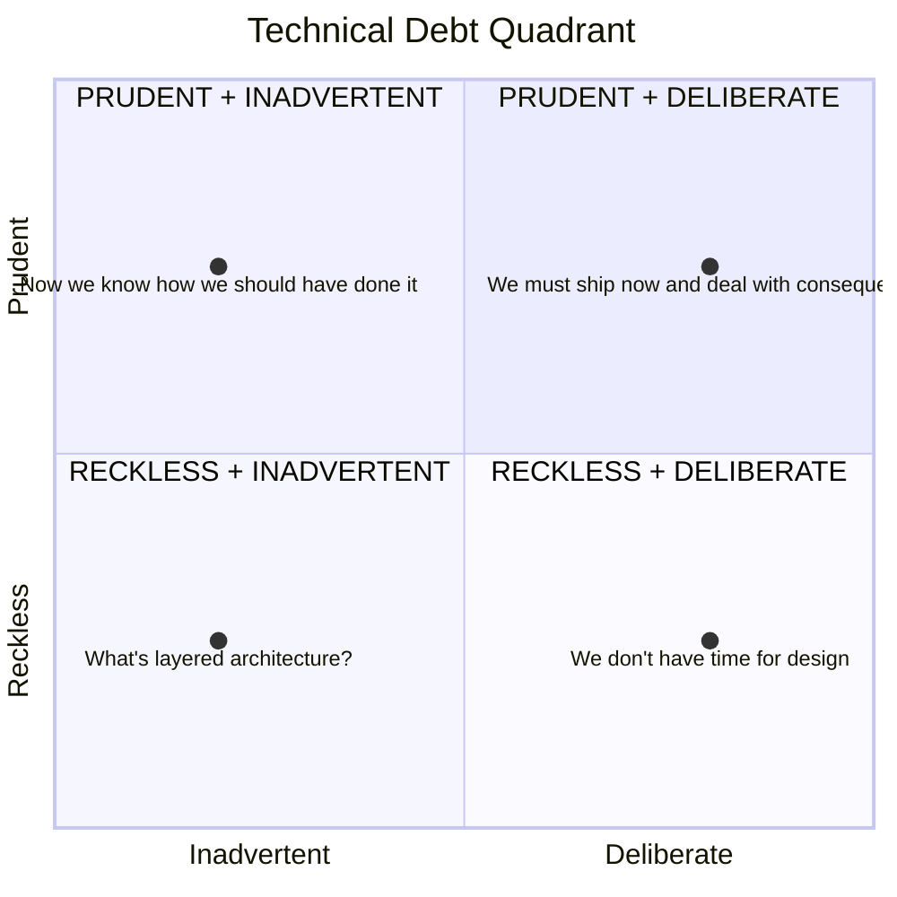
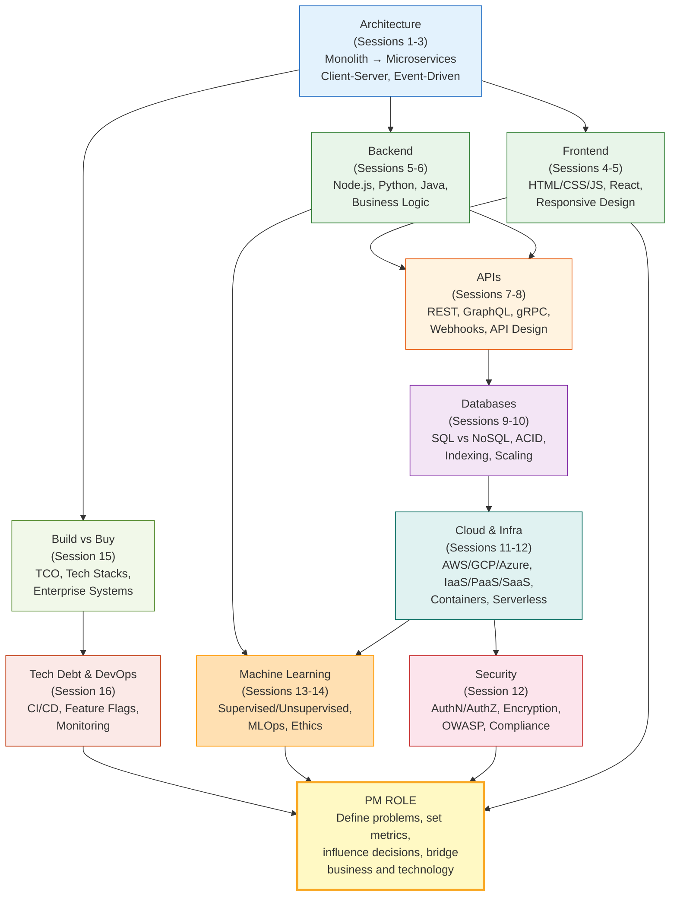

# Session 16 — Technical Debt, DevOps & Module 1 Wrap-Up

> **This is the final session of Module 1.** We cover technical debt management, the deployment pipeline, and then connect every topic from Sessions 1-16 into a unified mental model of how technology products are built and run.

---

## What Is Technical Debt?

[[Technical-Debt]] is the **implied cost of future rework caused by choosing a quick-and-easy solution now instead of a better approach that would take longer**. #definition

### The Credit Card Analogy

Technical debt works exactly like financial debt:

| Financial Debt | Technical Debt |
|---------------|----------------|
| Borrow money to buy something now | Ship code quickly with shortcuts |
| Pay interest every month | Spend extra time working around the shortcuts |
| Principal = original amount borrowed | Principal = effort to fix the shortcuts properly |
| Interest compounds if unpaid | Debt compounds — shortcuts make future shortcuts harder |
| Too much debt = bankruptcy | Too much debt = system is unmaintainable, must be rewritten |

> "Shipping first time code is like going into debt. A little debt speeds development so long as it is paid back promptly with a rewrite. The danger occurs when the debt is not repaid. Every minute spent on not-quite-right code counts as interest on that debt." -- Ward Cunningham, who coined the term

### Why Technical Debt Is Not Always Bad

**Good debt** (like a mortgage): Taking on deliberate, managed debt to ship an MVP faster and validate the market. If the product fails, you saved months of "proper" engineering on something no one wanted.

**Bad debt** (like maxed credit cards): Accumulating debt through carelessness, ignorance, or relentless pressure to ship without ever paying it back.

---

## Types of Technical Debt: The 2x2 Matrix

Martin Fowler's technical debt quadrant: #framework



### The Four Quadrants Explained

#### Quadrant 1: Reckless + Deliberate
> "We don't have time for design."

The team knowingly cuts corners under pressure and has no plan to fix it. This is the most dangerous type — it accumulates fast and compounds.

**Example:** Hardcoding API keys, skipping tests, copy-pasting code instead of creating shared modules.

#### Quadrant 2: Reckless + Inadvertent
> "What's layered architecture?"

The team does not know better. They are not deliberately cutting corners — they lack the knowledge to build it properly.

**Example:** Junior team building their first system without architectural guidance. The code works but is unmaintainable.

#### Quadrant 3: Prudent + Deliberate
> "We must ship now and deal with the consequences."

The team understands the tradeoff and makes a **conscious decision** to take on debt for a valid business reason, with a plan to pay it back.

**Example:** "We'll use a simple SQLite database for the MVP. If we get traction, we'll migrate to PostgreSQL in Q2." This is healthy debt management.

#### Quadrant 4: Prudent + Inadvertent
> "Now we know how we should have done it."

The team did their best, but only after building the system did they understand the better approach. This is natural learning.

**Example:** After a year of running the system, the team realizes the data model should have been designed differently. This is inevitable in complex systems.

#pm-implication PMs should primarily be concerned with **Quadrant 1 (reckless + deliberate)** debt. When business pressure forces shortcuts, the PM must ensure the debt is **tracked and scheduled for repayment**, not ignored.

---

## Signs Your Stack Needs Modernization

When your engineering team complains, listen for these signals: #framework

| Warning Sign | What It Means | Severity |
|-------------|---------------|----------|
| **Deploys take hours** | Deployment pipeline has too many manual steps or the test suite is too slow | Medium |
| **Can't hire** | Stack is outdated or obscure; candidates don't want to work with it | High |
| **Scaling limits** | Architecture cannot handle growing load without fundamental redesign | High |
| **Security vulnerabilities pile up** | Dependencies are outdated, patches are not applied | Critical |
| **Features take 10x longer than expected** | Codebase is so tangled that every change risks breaking something else | Very High |
| **Only one person understands the system** | Knowledge concentration ("bus factor = 1") | High |
| **Tests are unreliable** | Flaky tests that pass/fail randomly, so the team ignores them | Medium-High |
| **Customer-facing bugs increasing** | Regression rate is climbing despite (or because of) faster shipping | High |

---

## Measuring Technical Debt

You cannot manage what you cannot measure. Four key metrics: #framework

### DORA Metrics (DevOps Research and Assessment)

These four metrics, validated by Google's DORA team across thousands of organizations, predict both software delivery performance and organizational performance:

| Metric | What It Measures | Elite | Low |
|--------|-----------------|-------|-----|
| **Deployment Frequency** | How often code ships to production | Multiple times per day | Less than once per month |
| **Lead Time for Changes** | Time from commit to production | Less than 1 hour | More than 6 months |
| **Change Failure Rate** | % of deployments causing failures | 0-15% | 46-60% |
| **Time to Restore** | Time to recover from a failure | Less than 1 hour | More than 6 months |

### Additional Tech Debt Indicators

- **Developer velocity:** Measure feature throughput over time. If it is declining with the same team size, debt is accumulating.
- **Bug rate:** Ratio of bug-fix commits to feature commits. Healthy is under 20%.
- **Code coverage:** Percentage of code covered by automated tests. Below 60% is risky.
- **Dependency freshness:** How many dependencies are more than 2 major versions behind.

---

## Managing Technical Debt as a PM

### The 20% Rule #framework

Allocate approximately **20% of each sprint's capacity to technical debt reduction**. This is not a luxury — it is preventive maintenance.

| Allocation | Sprint Capacity (10 dev-days) | Result |
|-----------|------------------------------|--------|
| 0% debt work | 10 days features | Debt accumulates, velocity drops, eventually crisis |
| 20% debt work | 8 days features, 2 days debt | Sustainable pace, debt stays manageable |
| 50% debt work | 5 days features, 5 days debt | "Debt sprint" — use when debt is critical |
| 100% debt work | 0 features, 10 days debt | Emergency — product is nearly unmaintainable |

### Tech Debt Prioritization: The Impact x Effort Matrix

#pm-implication Not all debt is worth paying off. Prioritize debt that **blocks the most value with the least effort**.

| | Low Effort | High Effort |
|--|-----------|-------------|
| **High Impact** | **Do first.** Quick wins that unblock significant velocity. Example: fix flaky CI pipeline. | **Plan carefully.** Major infrastructure work that will pay dividends. Example: migrate to typed API contracts. |
| **Low Impact** | **Fill in.** Nice-to-have improvements for slow sprints. Example: refactor naming conventions. | **Don't bother.** Not worth the investment. Example: rewrite a stable legacy service that rarely changes. |

### How to Advocate for Debt Reduction

Engineers will say "we need to refactor." Executives will say "where are the features?" The PM must translate. #pm-implication

**Wrong framing:** "We need to pay down technical debt."
**Right framing:** "If we invest 2 weeks in fixing the deployment pipeline, we can ship features 30% faster for the rest of the year. That's equivalent to adding 1.5 developers to the team."

Always frame debt work in terms of **business outcomes**: velocity gained, incidents prevented, hiring unlocked, customer impact avoided.

---

## DevOps and CI/CD

### What Is DevOps?

[[DevOps]] is a set of practices that **unifies software development (Dev) and IT operations (Ops)** to shorten the development lifecycle and deliver high-quality software continuously. #definition

### What Is CI/CD?

[[CI-CD]] — Continuous Integration and Continuous Deployment — is the **automation pipeline that takes code from a developer's laptop to production**. #definition

- **Continuous Integration (CI):** Every code change is automatically built, tested, and validated
- **Continuous Delivery (CD):** Code is always in a deployable state; deployment to production can happen at any time
- **Continuous Deployment:** Every change that passes all automated checks is **automatically** deployed to production (no manual gate)

### The CI/CD Pipeline

```mermaid
flowchart LR
    CODE[1. Code<br/>Developer commits] --> BUILD[2. Build<br/>Compile & package]
    BUILD --> TEST[3. Test<br/>Unit, integration,<br/>end-to-end]
    TEST --> SEC[4. Security Scan<br/>Vulnerability check,<br/>dependency audit]
    SEC --> STAGE[5. Staging<br/>Deploy to test<br/>environment]
    STAGE --> APPROVE{"6. Approval<br/>Gate"}
    APPROVE -->|Manual or auto| PROD[7. Production<br/>Deploy to users]
    PROD --> MON[8. Monitor<br/>Track health,<br/>errors, performance]
    MON -->|Issue detected| ROLL[Rollback<br/>Revert to last<br/>good version]
    style CODE fill:#e3f2fd,stroke:#1565C0
    style BUILD fill:#e8f5e9,stroke:#2e7d32
    style TEST fill:#fff9c4,stroke:#f9a825
    style SEC fill:#fce4ec,stroke:#c62828
    style STAGE fill:#f3e5f5,stroke:#7b1fa2
    style PROD fill:#c8e6c9,stroke:#2e7d32
    style MON fill:#fff3e0,stroke:#e65100
    style ROLL fill:#ffcdd2,stroke:#c62828
```



### Key DevOps Tools

| Category | Tools | What They Do |
|----------|-------|-------------|
| **CI/CD Orchestration** | GitHub Actions, GitLab CI, Jenkins, CircleCI | Automate the build-test-deploy pipeline |
| **Containerization** | Docker | Package applications with all dependencies into portable containers |
| **Container Orchestration** | Kubernetes (K8s) | Manage and scale containers across a cluster of machines |
| **Infrastructure as Code** | Terraform, Pulumi, AWS CDK | Define infrastructure in code — reproducible, version-controlled |
| **[[Feature-Flags]]** | LaunchDarkly, Unleash, Flagsmith | Toggle features on/off without deploying new code |
| **Secrets Management** | HashiCorp Vault, AWS Secrets Manager | Securely store and access API keys, passwords, certificates |

#pm-implication PMs do not need to use these tools directly, but must understand what the pipeline looks like. When engineering says "We can't ship that today because CI is red," you should understand what that means and how long it typically takes to resolve.

---

## Feature Flags: Decoupling Deployment from Release

[[Feature-Flags]] are one of the most powerful tools a PM can leverage. They allow you to **deploy code to production without releasing the feature to users**. #definition

### How Feature Flags Work

```
Without feature flags:
  Deploy code  =  Release feature  (all at once, to everyone)

With feature flags:
  Deploy code  ≠  Release feature
  Code is in production but behind a flag (toggle)
  PM/team controls who sees the feature and when
```

### Feature Flag Use Cases

| Use Case | How It Works | PM Benefit |
|----------|-------------|------------|
| **Gradual rollout** | Release to 1% → 10% → 50% → 100% of users | Catch bugs before full impact |
| **A/B testing** | Show variant A to 50%, variant B to 50% | Measure which version performs better |
| **Beta programs** | Enable for opted-in users only | Get early feedback without risk |
| **Kill switch** | Instantly disable a broken feature | Recovery in seconds, not hours |
| **Regional rollout** | Enable for India first, then global | Test in one market before expanding |
| **Time-based** | Enable on Black Friday, disable after | Seasonal features without deployment |

#pm-implication Feature flags give PMs **direct control over release timing** without depending on engineering for a deployment. This is transformative for launch planning, A/B testing, and risk management.

### Feature Flag Hygiene

Flags that stay forever become their own form of [[Technical-Debt]]. For every flag:
- Set a **removal date** at creation time
- Review all active flags monthly
- Remove the flag and dead code path once the feature is fully rolled out

---

## Monitoring and Observability

### The Difference

- **Monitoring** tells you **something is wrong** (alert: error rate spiked)
- **Observability** tells you **why it is wrong** (the payment service is timing out because the database connection pool is exhausted)

### [[Monitoring-Observability|The Three Pillars of Observability]]

| Pillar | What It Captures | Tool Examples |
|--------|-----------------|---------------|
| **Metrics** | Numerical measurements over time (error rate, latency, CPU usage) | Datadog, Prometheus + Grafana, New Relic |
| **Logs** | Detailed text records of events | ELK Stack (Elasticsearch, Logstash, Kibana), Splunk |
| **Traces** | End-to-end path of a request through microservices | Jaeger, Zipkin, Datadog APM |

### Key Monitoring Tools

| Tool | Primary Use | Why PMs Care |
|------|-----------|-------------|
| **Datadog** | Full-stack monitoring (metrics, logs, traces) | Unified view of system health for incident response |
| **New Relic** | Application performance monitoring (APM) | Identify which features cause performance issues |
| **Grafana** | Visualization dashboards for metrics | Build PM-facing dashboards for SLA tracking |
| **Sentry** | Error tracking and crash reporting | See exactly which errors users encounter |
| **PagerDuty / OpsGenie** | Incident alerting and on-call management | Understand your team's incident response process |

### What PMs Should Monitor

1. **Error rate:** Percentage of requests that fail — aim for < 0.1%
2. **Latency (p50, p95, p99):** Response time — p50 is typical, p99 is worst case
3. **Uptime / Availability:** Target 99.9% (three nines) or 99.99% (four nines)
4. **Core user flows:** Track completion rates for critical journeys (signup, checkout, payment)
5. **Feature adoption:** Measure usage of new features post-launch

#pm-implication A PM who can read a Grafana dashboard during an incident earns immediate respect from the engineering team — and makes better decisions about prioritization.

---

## Emerging Technologies Overview

Technologies on the horizon that PMs should track: #framework

### WebAssembly (Wasm)
- **What:** Run near-native-speed code in the browser (compiled from C, Rust, Go, etc.)
- **PM relevance:** Enables complex applications in the browser (Figma, Google Earth, video editing) that previously required desktop apps
- **Timeline:** Production-ready now for specific use cases

### Edge Computing
- **What:** Run compute at the network edge (near users) instead of centralized data centers
- **PM relevance:** Ultra-low latency for real-time applications, data sovereignty compliance
- **Example:** Cloudflare Workers, AWS Lambda@Edge, Vercel Edge Functions
- **Timeline:** Mainstream adoption underway

### AI-Native Development
- **What:** Development tools with AI built in — code generation, automated testing, code review
- **PM relevance:** 2-5x developer productivity gains, changes how you estimate timelines
- **Example:** GitHub Copilot, Cursor, AI-assisted code review
- **Timeline:** Rapidly maturing

### Serverless Databases
- **What:** Databases that auto-scale to zero when unused and scale up on demand
- **PM relevance:** No capacity planning needed, pay only for actual usage
- **Example:** PlanetScale, Neon (serverless PostgreSQL), DynamoDB
- **Timeline:** Production-ready now

### No-Code / Low-Code Platforms
- **What:** Build applications without traditional programming
- **PM relevance:** PMs can prototype and even ship internal tools without engineering
- **Example:** Retool (internal tools), Bubble (web apps), Zapier (automation)
- **Timeline:** Mature for specific use cases; not replacing custom development for complex products

---

## Module 1 Wrap-Up: Connecting All the Dots

### The Module 1 Knowledge Map

This map connects every major topic from Sessions 1-16 into a unified mental model. #framework



### The PM's Technology Mental Model: Key Principles

After 16 sessions, these are the principles that unite everything: #framework

**1. Users see the frontend, business runs on the backend, data is the foundation.**
Every product is the interplay of what users touch ([[Tech-Stacks|frontend]]), the logic that powers it (backend), and the data that makes it valuable ([[Technical-Debt|databases]]).

**2. APIs are the connective tissue.**
Modern products are built by connecting services through APIs. The quality of your API design determines how fast you can iterate and integrate.

**3. Cloud enables scale; security protects it.**
Cloud infrastructure lets you scale without buying hardware. Security is not a feature — it is a property of every feature.

**4. ML learns from data; PMs define what to learn.**
[[Machine-Learning]] is a tool. PMs define the problem, set the metrics, ensure fairness, and plan for [[Model-Drift|drift]].

**5. Build what differentiates you; buy everything else.**
[[Build-vs-Buy]] is a strategic allocation of your most scarce resource: engineering time.

**6. Technical debt is a product management responsibility.**
[[Technical-Debt]] is not "an engineering problem." PMs who ignore it ship slower and slower until the product stalls.

**7. Ship fast, but measure everything.**
[[CI-CD]], [[Feature-Flags]], and [[Monitoring-Observability|monitoring]] let you ship with confidence. Deploy is not the end — it is the beginning of learning.

---

## Quiz Preparation Topics

### Module 1 Key Concepts Checklist

Use this checklist to prepare for the Module 1 assessment:

**Architecture & Design**
- [ ] Client-server architecture
- [ ] Monolithic vs microservices — when to use each
- [ ] Event-driven architecture
- [ ] Scalability patterns (horizontal vs vertical)

**Frontend & Backend**
- [ ] Frontend frameworks (React, Vue, Angular) — tradeoffs
- [ ] Backend languages and their strengths
- [ ] Server-side vs client-side rendering

**APIs**
- [ ] REST principles and HTTP methods
- [ ] GraphQL vs REST — when to use each
- [ ] API versioning, rate limiting, authentication
- [ ] Webhooks and event-driven APIs

**Databases**
- [ ] SQL vs NoSQL — when to use each
- [ ] ACID properties
- [ ] Indexing and query optimization
- [ ] Database scaling (read replicas, sharding)

**Cloud & Infrastructure**
- [ ] IaaS vs PaaS vs SaaS
- [ ] Containers (Docker) and orchestration (Kubernetes)
- [ ] Serverless computing — benefits and limitations
- [ ] Multi-cloud and cloud provider selection

**Security**
- [ ] Authentication vs authorization
- [ ] OWASP Top 10 vulnerabilities
- [ ] Encryption (at rest, in transit)
- [ ] Compliance frameworks (GDPR, DPDP Act, SOC 2)

**Machine Learning**
- [ ] Supervised vs unsupervised vs reinforcement learning
- [ ] [[ML-Evaluation-Metrics|Key evaluation metrics]] — precision, recall, F1, AUC-ROC
- [ ] [[Bias-Variance-Tradeoff]] — overfitting vs underfitting
- [ ] [[MLOps]] pipeline and [[Model-Drift]]
- [ ] [[ML-Ethics|Fairness and bias]] in ML
- [ ] [[Ensemble-Methods]] — bagging, boosting, stacking

**Build vs Buy & Stacks**
- [ ] [[Build-vs-Buy]] decision framework (6 dimensions)
- [ ] Total cost of ownership
- [ ] [[Tech-Stacks|Stack selection]] criteria (7 dimensions)
- [ ] Common mistakes (premature microservices, "use what Netflix uses")

**Tech Debt & DevOps**
- [ ] [[Technical-Debt]] quadrant (deliberate/inadvertent, reckless/prudent)
- [ ] DORA metrics
- [ ] [[CI-CD]] pipeline stages
- [ ] [[Feature-Flags]] — use cases and hygiene
- [ ] [[Monitoring-Observability]] — metrics, logs, traces

---

## Final PM Thought

> Technology is not the product. The product is the outcome for the user. Technology is the tool that makes the outcome possible at scale. A great PM understands the tool well enough to wield it wisely — knowing what it can do, what it cannot, and when to trust the specialists who built it.

---

## Discussion Questions

1. Your team has accumulated significant technical debt over 2 years of rapid shipping. The CEO asks "Why are we shipping features slower now than when we were a 5-person team?" How do you explain technical debt and propose a plan?
2. You are evaluating whether to invest in a monitoring platform (Datadog at $30K/year) or build basic monitoring with open-source tools. Walk through the build-vs-buy analysis.
3. Looking back at Module 1, which technology concept do you think is most underappreciated by PMs in industry? Why?

---

*Module 1 Complete. Module 2 begins with [[Session-17-Deep-Learning-LLMs]] — Deep Learning, Neural Networks, and the LLM Revolution.*
